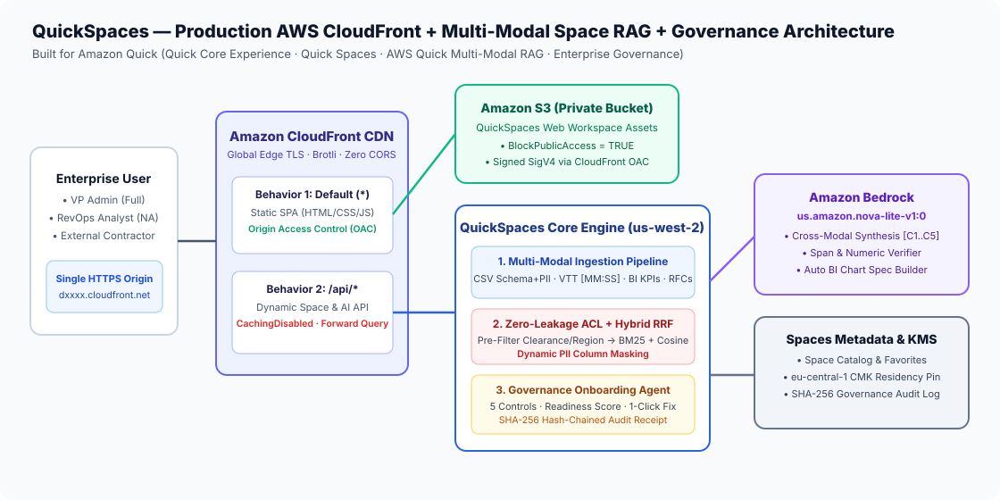

# QuickSpaces — Multi-Modal Enterprise AI Workspace, Hybrid RAG & Governance Agent

**Live Production App (Amazon CloudFront + Private S3 OAC + Bedrock Nova):** https://d2gltlwyzbnbxr.cloudfront.net

**QuickSpaces** is a full-stack enterprise workspace modeled directly on the **Amazon Quick / Quick Suite** platform architecture:
1. **Spaces & Asset Metadata Layer**: Organizes spreadsheets (`.csv`), BI KPI dashboards, timestamped call recordings (`.vtt`), and engineering RFCs (`.md`) into collaborative **Spaces** with favorites, owner lineage, and regional residency metadata.
2. **Multi-Modal Ingestion Pipeline**:
   - **CSV / Table Parser**: Extracts column types, pre-computes numeric rollups (`sum`, `avg`, `min`, `max`), and automatically detects PII columns (`email`, `phone`, `ssn`) for dynamic viewer masking.
   - **Call Transcript Parser**: Splits `.vtt` recordings into speaker-attributed `[MM:SS]` timestamp chunks for exact conversational citations.
   - **BI Dashboard & Document Parsers**: Indexes KPI series, SQL warehouse lineage, anomaly callouts, and hierarchical section anchors (`§2.1`, `§3.1`).
3. **Zero-Leakage ACL Pre-Filtered Hybrid Search & Amazon Bedrock Nova Copilot**:
   - Enforces tenant, regional residency (`NA`, `EMEA`, `APAC`), and clearance (`PUBLIC`, `INTERNAL`, `CONFIDENTIAL`) **before** BM25 + semantic n-gram cosine Reciprocal Rank Fusion (RRF) scoring so unauthorized chunks never enter prompt assembly.
   - Synthesizes cross-modal answers via **Amazon Bedrock (`us.amazon.nova-lite-v1:0`)**, verifies inline `[C1]..[C5]` citations against retrieved spans, and auto-generates an interactive BI chart when tabular metrics match.
4. **Enterprise Governance Onboarding Agent**:
   - Audits Spaces across **5 enterprise governance rules** (unmasked PII columns, external guest link drift, missing `eu-central-1` KMS residency pins, unverified BI owner SLAs, and confidential transcript retention tags), scores readiness (`0–100`), and executes **1-click policy remediation** with SHA-256 hash-chained audit receipts.



---

## Measured Benchmark Results (`benchmarks/run_benchmarks.py`)

| Metric | Measured Result |
| :--- | :--- |
| **Hybrid Top-3 Asset Recall** (BM25 + N-Gram Cosine RRF + Asset Max-Pooling) | **90.0%** (up from 80.0% chunk-only ranking) |
| **Zero-Leakage ACL Pre-Filter Block Rate** (5 adversarial contractor/clearance probes) | **100.0%** (0 unauthorized spans leaked) |
| **Citation Span Verification Precision** | **100.0%** |
| **Hybrid Search Latency** | **0.67 ms p50 / 1.15 ms p95** |
| **Governance Readiness Lift** (3 Enterprise Spaces, 5 controls) | **59.7 / 100 &rarr; 100 / 100** |

---

## What You Can Do Live in the Web App

1. **Switch Governance Personas in Real Time** (`Viewing As Role` in top-right):
   - **VP Engineering (Admin)**: Full `NA + EMEA` `CONFIDENTIAL` access + raw PII visibility.
   - **RevOps Analyst (NA Internal)**: `NA`-only `INTERNAL` clearance; open `q3_arr_retention_cohorts.csv` to watch `account_exec_email` (`sa***@acmecloud.io`) and `cfo_contact_phone` (`+*-***-***-0142`) mask dynamically.
   - **External Partner (Contractor)**: `PUBLIC`-only access; ask about confidential NordBank EMEA ARR contraction and see ACL Pre-Filter block all 4 confidential/internal sources *before* retrieval.
2. **Ask Cross-Modal Questions (`Ask Quick AI`)**:
   - Ask *"Why did EMEA Enterprise net retention dip in Q3, how much ARR contracted, and when does the SCIM fix ship?"* to watch **Amazon Bedrock Nova** combine the **CSV cohort table**, **BI dashboard**, **`[08:45]` EMEA escalation call transcript**, and **RFC-042** into one verified answer with clickable `[C1]`..`[C5]` pills and an auto-rendered chart.
3. **Upload / Ingest Your Own File (`+ Ingest File / Asset`)**:
   - Drop any `.csv`, `.vtt`, or `.md` file (or load a 1-click sample), see automatic PII column detection + multi-modal chunking, and immediately query it in chat.
4. **Run the Governance Onboarding Agent**:
   - Inspect open policy violations (`62/100`) and click **Auto-Remediate All Violations** to apply PII masking, revoke guest shares, pin `eu-central-1` KMS residency, and emit a SHA-256 audit receipt (`100/100`).

---

## Run Locally & Deploy to Amazon CloudFront

```bash
# 1. Run unit tests & reproducible benchmarks
PYTHONPATH=. python3 -m unittest discover -s tests -v
PYTHONPATH=. python3 benchmarks/run_benchmarks.py

# 2. Start the interactive workspace locally (uses live AWS Bedrock if configured)
PYTHONPATH=. python3 -m quickspaces.server
# -> Open http://localhost:3095

# 3. Deploy to Amazon CloudFront + Private S3 (OAC) + /api/* + Amazon Bedrock (us-west-2)
chmod +x infra/deploy_cloudfront.sh
./infra/deploy_cloudfront.sh
```
